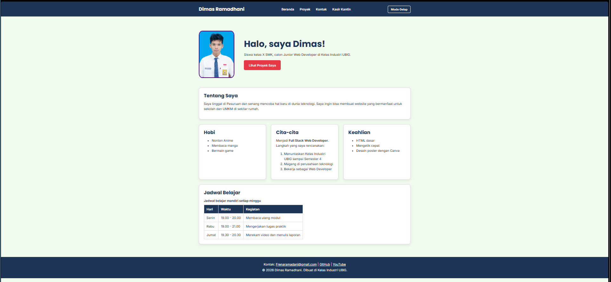
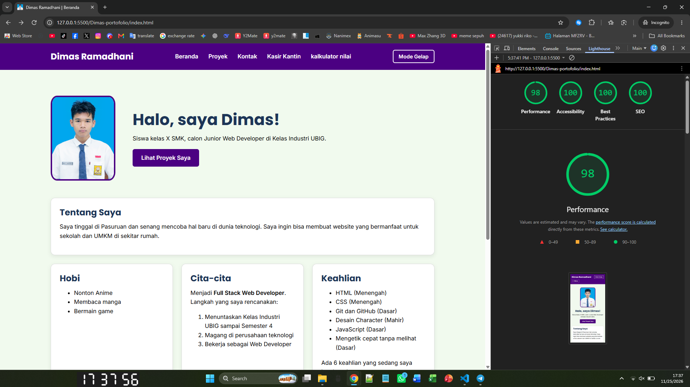

# Portofolio Dimas ramadhani
Website portofolio pribadi yang saya buat di Kelas Industri UBIG
(Paket 1, Minggu 01 sampai 05).
Website ini tampil rapi di ponsel, tablet, dan laptop.

---

## Tampilan

---

## Lighthouse Beranda

## Fitur
- Halaman **Beranda** berisi profil, hobi, cita-cita, keahlian, dan
jadwal belajar
- Halaman **Proyek** berisi daftar proyek dalam bentuk kartu
- Halaman **Kontak** berisi form untuk menghubungi saya
- Tampilan responsif dengan Flexbox dan *media query*

---

## Teknologi
- HTML5
- CSS3 (Flexbox dan media query)
- Git dan GitHub
- JavaScript
- JSON
- GitHub API

---

## Skore lighthouse (mobile)
- Beranda : Performance 97, Accessibility 100, Best Practices 100, SEO 100
- Proyek : Performance 100, Accessibility 100, Best Practices 100, SEO 100
- Kontak : Performance 100, Accessibility 100, Best Practices 100, SEO 100

---

## Tautan
- Website: https://indexhtml-beta-vert.vercel.app/
- Dibuat oleh: Dimas ramadhani, SMKN 1 Pasuruan